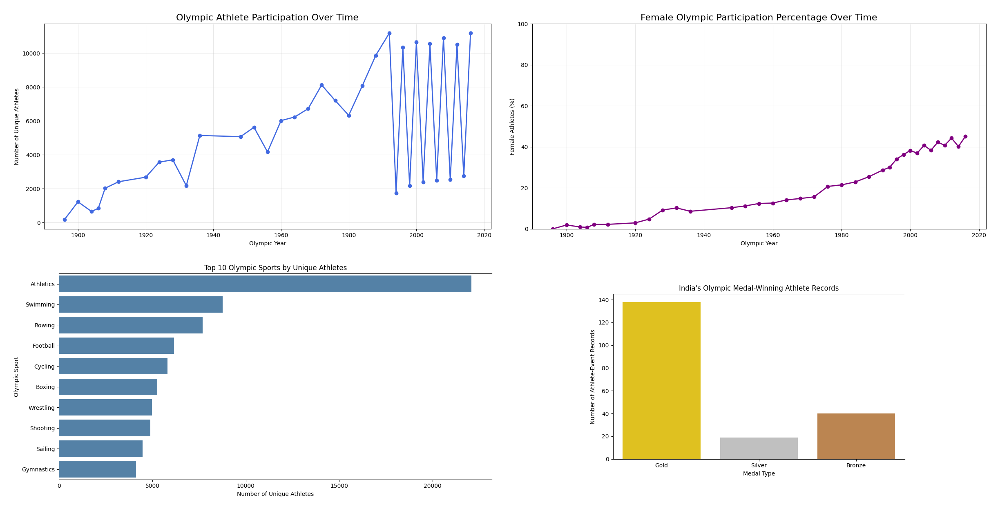

# 🏅 Olympics Data Analysis Using Python

### Exploratory Data Analysis | Data Cleaning | Data Visualization


---

## 📌 Project Overview

The **Olympics Data Analysis** project explores historical Olympic Games data using Python to understand athlete participation, gender representation, sport-wise participation, and India's medal-winning athlete records.

The project demonstrates the application of Python for data cleaning, exploratory data analysis (EDA), data aggregation, visualization, and analytical interpretation.

### Key Areas of Analysis

- Historical Olympic athlete participation
- Female athlete participation trends
- Top 10 Olympic sports by unique athletes
- India's Olympic medal-winning athlete records
- Data exploration and visualization
- Identification of historical patterns

---

## 📊 Project Dashboard — Four Key Visualizations

The following dashboard combines four visualizations developed during the Python analysis.



[🔍 View Dashboard in Full Size](./Olympics_Four_Charts_One_Page.png)

---

## 🎯 Project Objectives

1. Analyze historical Olympic athlete participation.
2. Understand changes in female representation over time.
3. Identify the sports with the highest number of unique athletes.
4. Examine India's Gold, Silver, and Bronze medal-winning athlete records.
5. Apply Python data manipulation and visualization techniques.
6. Communicate findings through meaningful charts.

---

## 🛠️ Tools and Technologies

| Technology | Purpose |
|------------|---------|
| Python | Data analysis and processing |
| Pandas | Data manipulation and aggregation |
| NumPy | Numerical operations |
| Matplotlib | Creating charts and visualizations |
| Seaborn | Statistical visualization, where used |
| Google Colab / Jupyter Notebook | Python development environment |
| CSV | Source dataset |

---

## 📂 Dataset Information

The project uses the historical Olympics dataset `athlete_events.csv`.

### Dataset Fields

| Column | Description |
|--------|-------------|
| ID | Athlete identifier |
| Name | Athlete name |
| Sex | Athlete gender |
| Age | Athlete age |
| Height | Athlete height in centimeters |
| Weight | Athlete weight in kilograms |
| Team | Represented team |
| NOC | National Olympic Committee code |
| Games | Olympic Games edition |
| Year | Olympic year |
| Season | Summer or Winter Olympics |
| City | Olympic host city |
| Sport | Olympic sport |
| Event | Sporting event |
| Medal | Gold, Silver, Bronze, or missing |

### Download Dataset

The original CSV is provided in a compressed ZIP archive to make it easier to store and share on GitHub.

[📥 Download Olympics Dataset](./Olympics_Dataset.zip)

Extract `athlete_events.csv` before running the notebook.

---

## 🧹 Data Cleaning and Preparation

The analysis involves inspecting and preparing the dataset for exploratory analysis.

### Data Quality Checks

- Examining missing values
- Checking duplicate records
- Reviewing column data types
- Understanding numerical and categorical variables
- Validating athlete and Olympic event information
- Reviewing medal categories and participation records

### Important Considerations

- Missing medal values generally indicate that an athlete did not receive a medal for that event.
- Some demographic fields contain missing values.
- An athlete may appear in multiple events or Olympic editions.
- Medal-winning athlete records are not necessarily equivalent to the number of unique medals awarded.

---

## 📈 Exploratory Data Analysis and Findings

### 1. Olympic Athlete Participation Over Time

**Objective:** Analyze how the number of unique athletes changed across Olympic years.

**Observations:**

- Athlete participation generally increased across the historical period.
- Earlier Olympic editions had significantly fewer athletes than more recent editions.
- Participation shows alternating high and low values in later years, reflecting differences between Olympic editions and seasons.

**Analytical significance:** Long-term participation trends provide insight into the expansion of the Olympic Games.

### 2. Female Olympic Participation Percentage Over Time

**Objective:** Examine changes in female representation in the Olympic Games.

**Observations:**

- Female participation was very limited during the earliest Olympic years.
- Representation increased gradually across the twentieth century.
- In the later years shown, female participation approached approximately 45% in the dataset.

**Analytical significance:** The trend highlights substantial historical growth in female representation.

### 3. Top 10 Olympic Sports by Unique Athletes

**Objective:** Identify sports with the largest numbers of unique athletes in the dataset.

**Observations:**

- Athletics has the highest unique-athlete count among the sports shown.
- Swimming ranks second, followed by Rowing.
- Football, Cycling, Boxing, Wrestling, Shooting, Sailing, and Gymnastics also feature among the top 10.

**Analytical significance:** Sport-wise comparisons reveal differences in participation scale and event structure.

### 4. India's Olympic Medal-Winning Athlete Records

**Objective:** Analyze India's medal-winning athlete-event records by medal category.

**Observations:**

- Gold has the highest number of medal-winning athlete-event records.
- Bronze ranks second.
- Silver has the lowest count among the three categories shown.

**Important:** These counts represent athlete-event medal records, not necessarily unique Olympic medals. Team events can contribute multiple athlete records for one medal-winning result.

**Analytical significance:** Medal-category analysis provides a historical view of India's medal-winning athlete records.

---

## 💡 Key Insights

| Analysis Area | Key Finding |
|---------------|-------------|
| Athlete Participation | Participation generally increased over the historical period |
| Female Representation | Female participation rose substantially over time |
| Sport-wise Analysis | Athletics recorded the highest unique-athlete count among the sports analyzed |
| India Medal Records | Gold had the highest athlete-event record count in the chart |

### Overall Conclusion

The analysis demonstrates how historical Olympic data can be used to identify participation patterns, study gender representation, compare sports, and investigate medal-winning records.

It also highlights the importance of correctly defining analytical metrics when interpreting sports data.

---

## 📁 Repository Structure

```text
Olympics-Data-Analysis-Python/
│
├── Olympics_Data_Analysis.ipynb
├── Olympics_Dataset.zip
├── Olympics_Four_Charts_One_Page.png
└── README.md
```

*The notebook filename should match the actual uploaded file.*

---

## 🚀 How to Run the Project

1. Download or clone the repository.
2. Extract `Olympics_Dataset.zip`.
3. Open the `.ipynb` notebook in Google Colab or Jupyter Notebook.
4. Install the required Python libraries.
5. Update the dataset file path if necessary.
6. Run the notebook cells sequentially.
7. Review the visualizations and analytical findings.

### Example: Load the Dataset

```python
import pandas as pd

df = pd.read_csv("athlete_events.csv")

df.head()
```

---

## 🎓 Skills Demonstrated

- Python Programming
- Data Cleaning and Validation
- Exploratory Data Analysis (EDA)
- Pandas Data Manipulation
- Grouping and Aggregation
- Time-Series Trend Analysis
- Data Visualization
- Sports Analytics
- Analytical Interpretation
- Data Storytelling

---

## 👨‍💻 About the Author

**Gurudev Mishra**

Data Analyst | MIS Reporting | Business Intelligence

**Technical Skills:** Python, SQL, Power BI, Tableau, Advanced Excel

[GitHub Profile](https://github.com/Gurudevmishra)

### Other Data Analytics Projects

- [🛒 BlinkIT Sales Analysis — Excel](https://github.com/Gurudevmishra/BlinkIT-Sales-Analysis-Excel)
- [🏦 Banking Analytics — Power BI](https://github.com/Gurudevmishra/Banking-Analytics-PowerBI)
- [🎮 Video Game Sales Analysis — Tableau](https://github.com/Gurudevmishra/Video-Game-Sales-Analysis-Tableau)

---

### ⭐ Turning Data into Insights and Insights into Decisions
